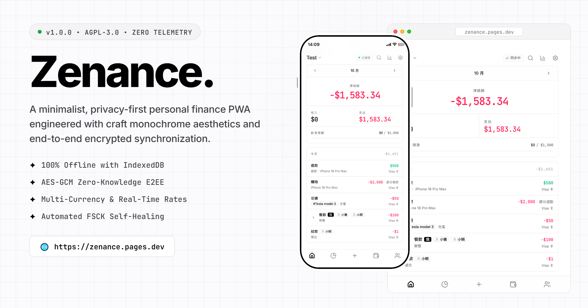

# Zenance.

[English](README.md) | [繁體中文](README.zh-TW.md) | [简体中文](README.zh-CN.md)

> A minimalist, privacy-first personal finance PWA engineered with uncompromising monochrome aesthetics and end-to-end encrypted synchronization.

[](https://zenance.pages.dev/)


<br>
<p align="center">
  
</p>
<br>

## FEATURES

- **Monochrome Aesthetics**: Engineered with strict high-contrast black and white styling, flat borders, zero drop shadows, and monospace typography for exact financial clarity.
- **Local-First & Offline Ready**: All financial data resides directly on your device via IndexedDB (Dexie.js), fully functional offline as an installable Progressive Web App (PWA).
- **End-to-End Encrypted Sync**: Secure bidirectional synchronization powered by Dropbox API and AES-GCM zero-knowledge encryption. Your data is encrypted locally before transmission.
- **Comprehensive Wealth Tracking**: Seamlessly manage multi-currency accounts, transfers, loans, debts, split payments, and real-time exchange rates.
- **Smart Budgets & Deep Analytics**: Category budgets with rollover tracking, visual spending breakdown, trend charts, and rich financial reports.
- **Time Machine & FSCK Integrity**: One-click full data snapshots, JSON backup and restore, automated integrity audits, and instant ledger repair routines.
- **Privacy & Security**: Built-in PIN code application lock with biometric-ready lock guards and zero tracking or telemetry.
- **Global Ready (i18n)**: Comprehensive multi-language support covering 11 locales, strictly formatted with Pangu spacing standards.

## TECH STACK

- **Framework**: React 19 / TypeScript / Vite
- **UI & Styling**: Tailwind CSS v4 / Shadcn UI / Base UI / Lucide Icons
- **State Management**: Zustand
- **Local Database**: IndexedDB (Dexie.js)
- **Cryptography & Sync**: Web Crypto API (AES-GCM / PBKDF2) / Dropbox API
- **PWA**: vite-plugin-pwa (Service Workers & Offline Caching)
- **Internationalization**: react-i18next

## INSTALLATION

### Live Web App (Instant Access)

Experience Zenance directly in your browser or install it as a PWA:
👉 **[https://zenance.pages.dev](https://zenance.pages.dev/)**

### Prerequisites

Ensure you have Node.js (>= 18.0.0) and npm installed on your system.

### Quick Start (Development)

```bash
git clone https://github.com/ChiesiMario/Zenance.git
cd Zenance
npm install
npm run dev
```

### Build for Production

```bash
npm run build
```

### PWA Deployment

Deploy the generated `dist/` directory to any static hosting provider supporting HTTPS (such as Vercel, Cloudflare Pages, Netlify, or GitHub Pages) for full PWA installability across desktop and mobile devices.

## ARCHITECTURE

Zenance follows a clean, modular architecture separating concerns across presentation, state, domain logic, and cryptographic persistence:

- `components/`: Atomic UI primitives, dialog modals, financial charts, and domain widgets.
- `pages/`: Primary application views (Dashboard, Accounts, Budgets, Reports, Contacts, Settings).
- `hooks/`: Decoupled business logic hooks managing reactive database queries and mutations.
- `services/`: IndexedDB storage schemas (Dexie), Web Crypto E2EE encryption, Dropbox sync adapters, and FSCK repair routines.
- `store/`: Lightweight global UI state management powered by Zustand.
- `i18n/`: Modular localization engines and locale bundles covering 11 languages.

## LICENSE

This project is licensed under the GNU Affero General Public License v3 (AGPLv3). See the [LICENSE](LICENSE) file for details.
