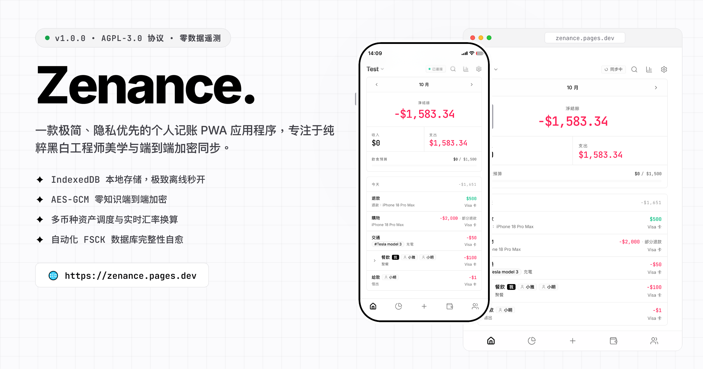

# Zenance.

[English](README.md) | [繁體中文](README.zh-TW.md) | [简体中文](README.zh-CN.md)

> 一款极简、隐私优先的个人记账 PWA 应用程序，专注于纯粹黑白工程师美学与端到端加密同步。

[](https://zenance.pages.dev/)


<br>
<p align="center">
  
</p>
<br>

## 核心功能

- **黑白极简美学**：严格贯彻高对比黑白单色美学、纯扁平细边框、零阴影，并采用等宽数字字体确保财务数据的精准与清晰。
- **本地优先与离线运行**：所有财务数据通过 IndexedDB (Dexie.js) 完整存储于您的本地设备，具备完整的离线操作能力，支持一键安装为 PWA 应用程序。
- **端到端加密同步**：基于 Dropbox API 与 AES-GCM 零知识加密技术的双向同步机制，数据在离开浏览器前即完成本地加密，确保绝对隐私。
- **全方位资产追踪**：轻松管理多币种账户、转账调度、借贷债务、代付分账以及实时汇率换算。
- **智慧预算与深度分析**：支持分类预算滚动追踪、可视化支出占比、趋势图表与全维度财务报表。
- **时光机备份与 FSCK 修复**：提供一键完整数据快照、JSON 导出导入、自动化数据库完整性校验与账本快速自愈修复工具。
- **安全锁与隐私防护**：内置应用程序 PIN 码锁定防护，支持闲置自动上锁，无任何数据追踪与遥测代码。
- **多语言国际化**：原生支持 11 种语言界面，并严格遵循盘古排版（Pangu Spacing）标准。

## 技术栈

- **框架**: React 19 / TypeScript / Vite
- **UI 与样式**: Tailwind CSS v4 / Shadcn UI / Base UI / Lucide Icons
- **状态管理**: Zustand
- **本地数据库**: IndexedDB (Dexie.js)
- **加密与同步**: Web Crypto API (AES-GCM / PBKDF2) / Dropbox API
- **PWA 引擎**: vite-plugin-pwa (Service Workers & 离线缓存)
- **多国语言**: react-i18next

## 安装与运行

### 线上即时体验 (Web App)

无需安装，即可直接在浏览器中开始使用或一键安装为 PWA：
👉 **[https://zenance.pages.dev](https://zenance.pages.dev/)**

### 环境要求

请确认您的系统已安装 Node.js (>= 18.0.0) 与 npm 包管理工具。

### 本地开发

```bash
git clone https://github.com/ChiesiMario/Zenance.git
cd Zenance
npm install
npm run dev
```

### 生产环境构建

```bash
npm run build
```

### PWA 部署

将构建完成的 `dist/` 目录部署至任何支持 HTTPS 的静态托管平台（例如 Vercel、Cloudflare Pages、Netlify 或 GitHub Pages），即可在移动设备与桌面端获得完整的 PWA 安装体验。

## 系统架构

Zenance 遵循高度模块化且职责分明的干净架构，彻底解耦 UI 展示层、状态管理、领域业务逻辑与加密持久化层：

- `components/`：原子级 UI 组件、弹窗对话框、图表视图与业务专用组件。
- `pages/`：应用程序核心页面（概览、账户、预算、报表、联系人、设置等）。
- `hooks/`：彻底解耦的业务逻辑 Hooks，负责响应式数据库查询与状态变更。
- `services/`：IndexedDB 数据结构 (Dexie)、Web Crypto 端到端加密、Dropbox 同步适配器与 FSCK 数据库修复例程。
- `store/`：基于 Zustand 的轻量级全局 UI 状态管理。
- `i18n/`：涵盖 11 种语言的模块化多语言配置与语言包。

## 授权条款

本项目采用 GNU Affero General Public License v3 (AGPLv3) 授权条款，完整内容请参阅 [LICENSE](LICENSE) 文件。
