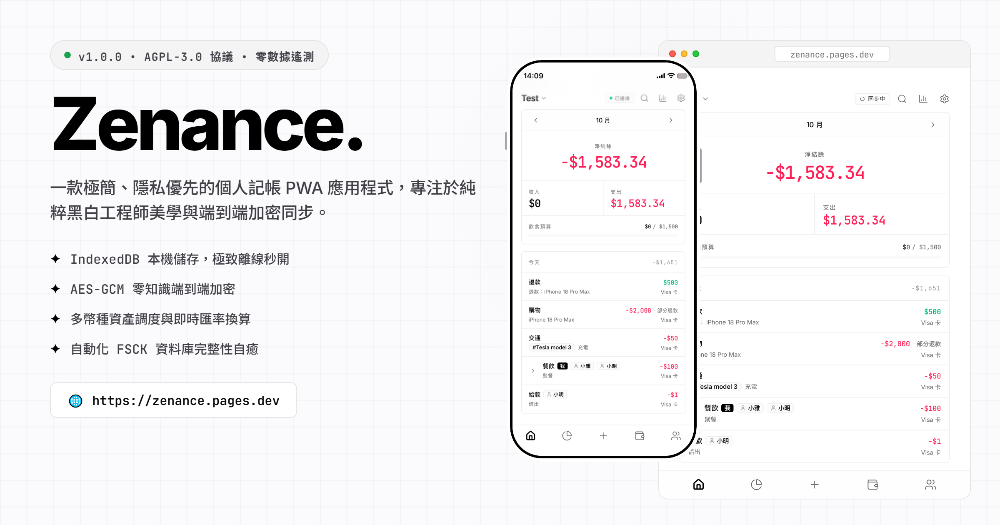

# Zenance.

[English](README.md) | [繁體中文](README.zh-TW.md) | [简体中文](README.zh-CN.md)

> 一款極簡、隱私優先的個人記帳 PWA 應用程式，專注於純粹黑白工程師美學與端到端加密同步。

[](https://zenance.pages.dev/)


<br>
<p align="center">
  
</p>
<br>

## 核心功能

- **黑白極簡美學**：嚴格貫徹高對比黑白單色美學、純扁平細邊框、零陰影，並採用等寬數字字體確保財務數據的精準與清晰。
- **本地優先與離線運行**：所有財務資料透過 IndexedDB (Dexie.js) 完整儲存於您的本機設備，具備完整的離線操作能力，支援一鍵安裝為 PWA 應用程式。
- **端到端加密同步**：基於 Dropbox API 與 AES-GCM 零知識加密技術的雙向同步機制，資料在離開瀏覽器前即完成本地加密，確保絕對隱私。
- **全方位資產追蹤**：輕鬆管理多幣種帳戶、轉帳調度、借貸債務、代付分帳以及即時匯率換算。
- **智慧預算與深度分析**：支援分類預算滾動追蹤、視覺化支出佔比、趨勢圖表與全維度財務報表。
- **時光機備份與 FSCK 修復**：提供一鍵完整資料快照、JSON 匯出匯入、自動化資料庫完整性校驗與帳本快速自癒修復工具。
- **安全鎖與隱私防護**：內建應用程式 PIN 碼鎖定防護，支援閒置自動上鎖，無任何數據追蹤與遙測代碼。
- **多語系國際化**：原生支援 11 種語言介面，並嚴格遵循盤古排版（Pangu Spacing）標準。

## 技術棧

- **框架**: React 19 / TypeScript / Vite
- **UI 與樣式**: Tailwind CSS v4 / Shadcn UI / Base UI / Lucide Icons
- **狀態管理**: Zustand
- **本地資料庫**: IndexedDB (Dexie.js)
- **加密與同步**: Web Crypto API (AES-GCM / PBKDF2) / Dropbox API
- **PWA 引擎**: vite-plugin-pwa (Service Workers & 離線快取)
- **多國語系**: react-i18next

## 安裝與執行

### 線上即時體驗 (Web App)

無需安裝，即可直接在瀏覽器中開始使用或一鍵安裝為 PWA：
👉 **[https://zenance.pages.dev](https://zenance.pages.dev/)**

### 環境需求

請確認您的系統已安裝 Node.js (>= 18.0.0) 與 npm 套件管理工具。

### 本地開發

```bash
git clone https://github.com/ChiesiMario/Zenance.git
cd Zenance
npm install
npm run dev
```

### 生產環境編譯

```bash
npm run build
```

### PWA 部署

將建置完成的 `dist/` 目錄部署至任何支援 HTTPS 的靜態託管平台（例如 Vercel、Cloudflare Pages、Netlify 或 GitHub Pages），即可在行動裝置與桌面端獲得完整的 PWA 安裝體驗。

## 系統架構

Zenance 遵循高度模組化且職責分明的乾淨架構，徹底解耦 UI 展示層、狀態管理、領域業務邏輯與加密持久化層：

- `components/`：原子級 UI 元件、彈窗對話框、圖表視圖與業務專用元件。
- `pages/`：應用程式核心頁面（總覽、帳戶、預算、報表、聯絡人、設定等）。
- `hooks/`：徹底解耦的業務邏輯 Hooks，負責響應式資料庫查詢與狀態變更。
- `services/`：IndexedDB 資料結構 (Dexie)、Web Crypto 端到端加密、Dropbox 同步配接器與 FSCK 資料庫修復常式。
- `store/`：基於 Zustand 的輕量級全域 UI 狀態管理。
- `i18n/`：涵蓋 11 種語言的模組化多語系設定與語系資源包。

## 授權條款

本專案採用 GNU Affero General Public License v3 (AGPLv3) 授權條款，完整內容請參閱 [LICENSE](LICENSE) 檔案。
